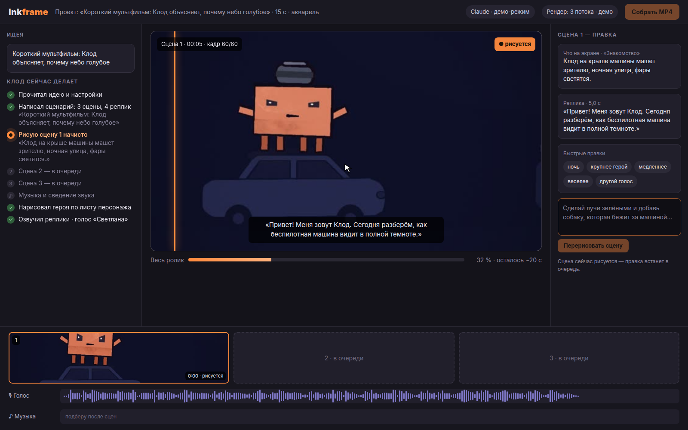

# Inkframe

**An open studio for hand-painted cartoons, written and drawn by Claude.**

You type an idea ("a cartoon for school kids: how a lidar sees the world, 60 s"), pick a style and a few settings.
Claude writes the script and the storyboard, then paints every scene frame by frame, and you watch the cartoon
being born on screen: pencil sketch first, then watercolour. Any scene can be fixed with a sentence and Claude
redraws only that scene. At the end you get an MP4 with a voice-over and music.

[Русская версия](README.ru.md) · **Live demo:** https://YOUR-GITHUB-NAME.github.io/inkframe/ *(appears after the first push, see [Demo site](#demo-site-github-pages))*


## Status: stage 1, demo mode

This is the first version. The studio screens are finished and work end to end, but the cartoon is played
by a **demo engine**: it replays a cartoon that was painted earlier with the same engine ("How a lidar works"),
as if Claude were drawing it right now. Nothing is sent to Claude yet.

| Works now | Comes in stage 2 |
|---|---|
| Start screen: idea, examples, 7 styles (Watercolour active), 8 settings | Claude writes `storyboard.json` through the Claude Agent SDK |
| Studio: "What Claude is doing" log, the stage with the pen, scene strip, voice and music lanes | Real painting: p5.js + p5.brush scenes rendered in headless Chrome |
| Sketch → colour for every scene, live over server-sent events | Voice with edge-tts, music ducked under the voice |
| Scene edits by text and quick-edit chips | Claude redraws only the edited scene |
| "Build MP4": player and download | ffmpeg glues scenes, voice and music |
| Own API key field (kept in `.env.local` only) | |

All screens talk to one interface, `StudioEngine` (`lib/engine/types.ts`). Stage 2 plugs in `RealEngine`
(`lib/engine/real.ts`) behind it, so the screens stay as they are.



## Run it

You need Node.js 20.9 or newer.

```bash
npm i
npm run dev          # http://127.0.0.1:3700
```

With Docker:

```bash
docker compose up --build    # http://127.0.0.1:3700
```

Settings live in `.env.local` (copy `.env.example`): `INKFRAME_ENGINE` (`demo` for now) and
`INKFRAME_DEMO_SPEED` (2 = twice as fast).

### Your Claude key

Click the **Claude** pill in the top bar and paste your Anthropic API key (`sk-ant-…`). It is written to
`.env.local` on your computer only; `.gitignore` keeps that file out of git, and the key is never sent back to the
browser. Without a key Inkframe will use the Claude Code login on the same computer (stage 2).

## Demo mode

The demo engine (`lib/engine/demo.ts`) plays a timed script of the same events the real engine will send:
storyboard, log steps, sketch frames, colour frames, voice and music tracks, the finished video. Its frames, sketch
twins and waveform peaks are cut from the lidar cartoon by `scripts/prepare-demo-assets.sh` into `public/demo/`.

| | |
|---|---|
|  |  |

A recorded walkthrough is in [`demo/walkthrough.mp4`](demo/walkthrough.mp4) (`npm run demo:record` makes a new one
while `npm run dev` is running).

### Demo site (GitHub Pages)

`npm run build:demo` builds the clickable demo as plain static files in `out/`. There is no server: the demo engine
runs in the browser tab (projects live until the tab is reloaded), and the studio opens at `/studio/?id=…`.

```bash
npm run build:demo                                   # site at the root of a domain
NEXT_PUBLIC_BASE_PATH=/inkframe npm run build:demo   # site at https://<user>.github.io/inkframe/
NEXT_PUBLIC_BASE_PATH=/inkframe npm run preview:demo # check it at http://127.0.0.1:3701/inkframe/
```

The build serves from the root of the base path, so open it through a web server, not by double-clicking
`index.html`.

[`.github/workflows/pages.yml`](.github/workflows/pages.yml) runs the tests, builds the demo and publishes it on
every push to `main`. Turn it on once: **Settings → Pages → Source: GitHub Actions**.

## Scripts

| Command | What it does |
|---|---|
| `npm run dev` | Studio on 127.0.0.1:3700 |
| `npm test` | Engine, reducer, demo-script and settings tests (Node test runner) |
| `npm run typecheck` | TypeScript check |
| `npm run build:demo` | Static demo site in `out/` (`--out=<dir>` for another folder) |
| `node scripts/check-static.mjs <url>` | Headless-Chrome smoke test of a demo site: start → draw → play the MP4 |
| `npm run demo:record` | Walkthrough video and screenshots into `demo/` |

## How it is built

Next.js (App Router), React, TypeScript, Tailwind CSS. The server keeps projects in memory and streams engine events
over SSE; the browser folds them with the same pure reducer (`lib/engine/reducer.ts`) the tests use.

## Thanks

- [ClaudeAnimationBase](https://github.com/JohnHeibel/ClaudeAnimationBase) by John Heibel (MIT): the painted
  cartoon engine and guide that Inkframe drives; the demo cartoon was made with it. Licence in
  [`licenses/ClaudeAnimationBase-LICENSE`](licenses/ClaudeAnimationBase-LICENSE).
- [p5.brush](https://github.com/acamposuribe/p5.brush) by Alejandro Campos (MIT) and [p5.js](https://p5js.org):
  the watercolour and ink brushes.
- [Claude](https://www.anthropic.com/claude) by Anthropic, who writes and paints the cartoons.

## Licence

[MIT](LICENSE).
