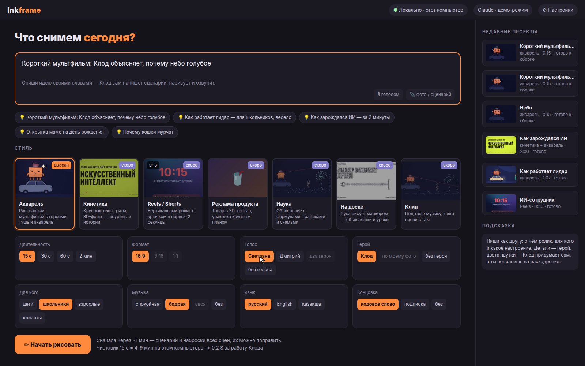
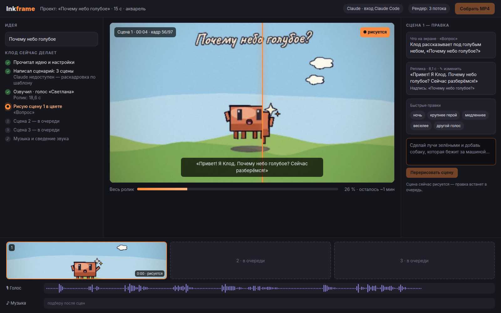
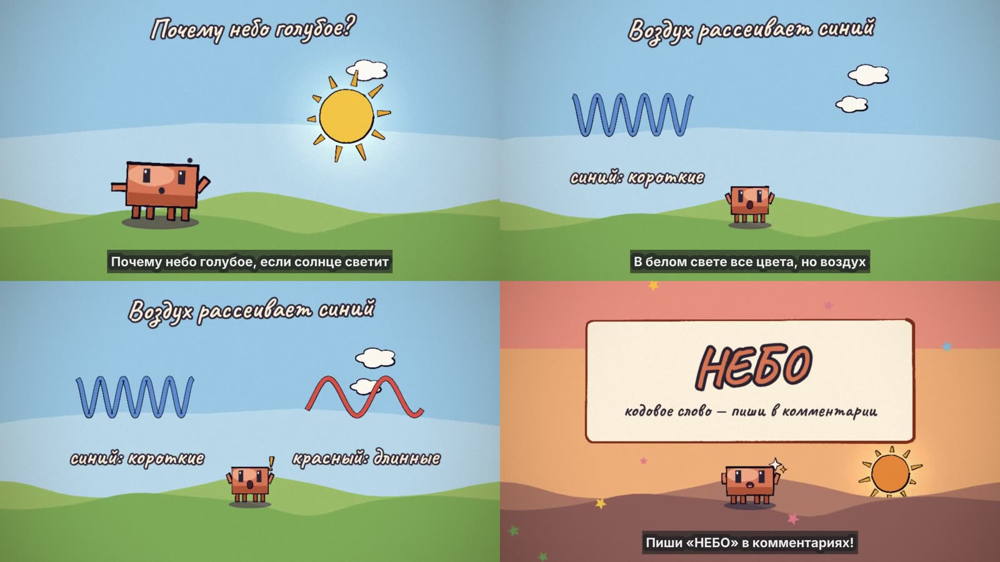
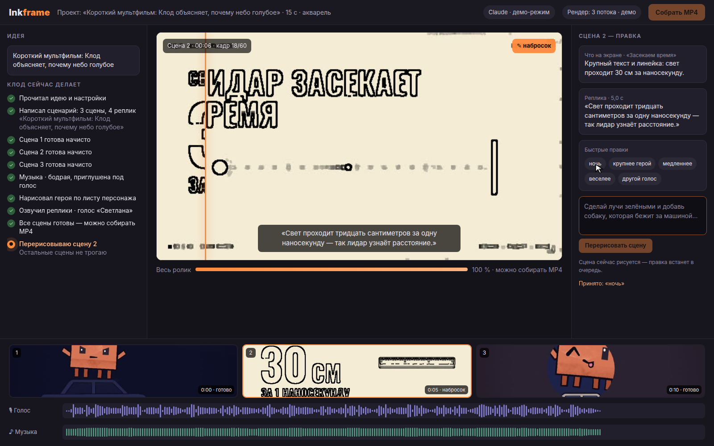
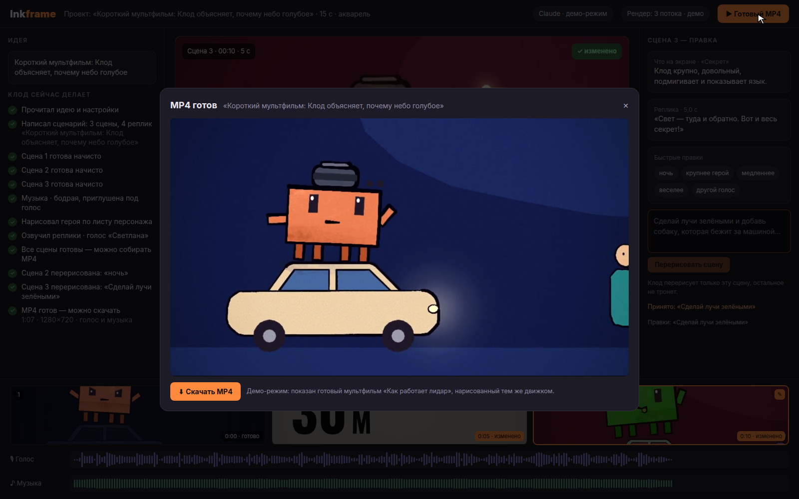

# Inkframe

**An open studio for hand-painted cartoons, written and drawn by Claude.**

You type an idea ("a cartoon for school kids: how a lidar sees the world, 60 s"), pick a style and a few settings.
Claude writes the script and the storyboard, then paints every scene frame by frame, and you watch the cartoon
being born on screen: pencil sketch first, then watercolour. Any scene can be fixed with a sentence and Claude
redraws only that scene. At the end you get an MP4 with a voice-over and music.

[Русская версия](README.ru.md) · **Live demo:** https://YOUR-GITHUB-NAME.github.io/inkframe/ *(appears after the first push, see [Demo site](#demo-site-github-pages))*



## Status: stage 2, the real engine

Inkframe has two engines behind one interface, `StudioEngine` (`lib/engine/types.ts`):

| | Demo engine (`INKFRAME_ENGINE=demo`, default) | Real engine (`INKFRAME_ENGINE=real`) |
|---|---|---|
| Storyboard | replays a finished cartoon | Claude writes it (`claude -p` on this computer); a template storyboard if Claude can't be reached |
| Drawing | pre-rendered frames on a timer | every scene painted with p5.js + p5.brush in headless Chrome: pencil sketch, then a colour draft, streamed live |
| Voice | waveform of the demo film | edge-tts on every line; scenes stretch to fit the voice |
| Scene edits | a CSS look | Claude (or simple rules) changes that scene's spec or words; only that scene is redrawn and re-voiced |
| MP4 | the demo film | 1280×720, 12 fps painted, cross-fades, voice over a ducked music bed, burned-in subtitles |

The GitHub Pages demo site always uses the demo engine.



### How the real engine paints

Claude never writes drawing code. The storyboard fills a **SceneSpec** per scene (`lib/real/scene-spec.ts`) and the
painter draws it from four templates (`renderer/templates.js`) and 25 props (`renderer/props.js`):

- `host`: Clawd talks to the viewer, a prop pops up beside him;
- `object`: one big prop with up to two labels and arrows;
- `compare`: two things side by side with captions, Clawd looks from one to the other;
- `card`: the end card with the code word.

Settings: room, sky, meadow, sunset, night, space, sea, board. Anything outside the lists is dropped, so a storyboard
can't break the painter.



Without a GPU, full watercolour fills cost 10–20 s a frame in software GL, so drafts and the final cut use flat washes
on the same paper grain (about 0.6 s a frame with three painters). `INKFRAME_WATERCOLOR=1` turns full watercolour back on
for the final cut. A 15 s cartoon takes about 1 minute for the drafts and 3 minutes for the MP4 on a 4-core server;
an edit redraws one scene in under a minute and the next MP4 re-paints only that scene.

## Run it

You need Node.js 20.9 or newer.

```bash
npm i
npm run dev          # http://127.0.0.1:3700
```

With Docker:

```bash
docker compose up --build    # http://127.0.0.1:3700
```

Settings live in `.env.local` (copy `.env.example`): `INKFRAME_ENGINE` (`demo` or `real`) and
`INKFRAME_DEMO_SPEED` (2 = twice as fast).

### The real engine

It needs, on the same computer: Chrome or Chromium (found automatically, or `CHROME_PATH`), ffmpeg, Python 3 with
`pip install edge-tts`, and Claude Code (`claude`) logged in, or your own API key (below).

```bash
INKFRAME_ENGINE=real npm run dev
```

Projects (drafts, clips, the MP4) are kept in `projects/`. All real-engine settings are listed in `.env.example`:
Claude timeout and model, template-only mode, the number of painters (at most 3), software GL, final render scale.

### Your Claude key

Click the **Claude** pill in the top bar and paste your Anthropic API key (`sk-ant-…`). It is written to
`.env.local` on your computer only; `.gitignore` keeps that file out of git, and the key is never sent back to the
browser. Without a key the real engine uses the Claude Code login on the same computer.

## Demo mode

The demo engine (`lib/engine/demo.ts`) plays a timed script of the same events the real engine will send:
storyboard, log steps, sketch frames, colour frames, voice and music tracks, the finished video. Its frames, sketch
twins and waveform peaks are cut from the lidar cartoon by `scripts/prepare-demo-assets.sh` into `public/demo/`.

| | |
|---|---|
|  |  |

A recorded walkthrough is in [`demo/walkthrough.mp4`](demo/walkthrough.mp4) (`npm run demo:record` makes a new one
while `npm run dev` is running).

### Demo site (GitHub Pages)

`npm run build:demo` builds the clickable demo as plain static files in `out/`. There is no server: the demo engine
runs in the browser tab (projects live until the tab is reloaded), and the studio opens at `/studio/?id=…`.

```bash
npm run build:demo                                   # site at the root of a domain
NEXT_PUBLIC_BASE_PATH=/inkframe npm run build:demo   # site at https://<user>.github.io/inkframe/
NEXT_PUBLIC_BASE_PATH=/inkframe npm run preview:demo # check it at http://127.0.0.1:3701/inkframe/
```

The build serves from the root of the base path, so open it through a web server, not by double-clicking
`index.html`.

[`.github/workflows/pages.yml`](.github/workflows/pages.yml) runs the tests, builds the demo and publishes it on
every push to `main`. Turn it on once: **Settings → Pages → Source: GitHub Actions**.

## Scripts

| Command | What it does |
|---|---|
| `npm run dev` | Studio on 127.0.0.1:3700 |
| `npm test` | Engines, reducer, storyboard, sound, subtitles and settings tests (Node test runner, no Chrome needed) |
| `npm run typecheck` | TypeScript check |
| `npm run build:demo` | Static demo site in `out/` (`--out=<dir>` for another folder) |
| `node scripts/check-static.mjs <url>` | Headless-Chrome smoke test of a demo site: start → draw → play the MP4 |
| `npm run demo:record` | Walkthrough video and screenshots into `demo/` |
| `node --import tsx scripts/paint-check.ts <out.jpg> [rs] [width] [sketch\|fast]` | Paints sample scenes of every template into one contact sheet |

## How it is built

Next.js (App Router), React, TypeScript, Tailwind CSS. The server streams engine events over SSE; the browser folds
them with the same pure reducer (`lib/engine/reducer.ts`) the tests use. The real engine lives in `lib/engine/real.ts`
and `lib/real/` (storyboard, Claude CLI, painter, sound, ffmpeg); the painted stage in `renderer/`.

## Thanks

- [ClaudeAnimationBase](https://github.com/JohnHeibel/ClaudeAnimationBase) by John Heibel (MIT): the painted
  cartoon engine and guide that Inkframe drives; the demo cartoon was made with it. Licence in
  [`licenses/ClaudeAnimationBase-LICENSE`](licenses/ClaudeAnimationBase-LICENSE).
- [p5.brush](https://github.com/acamposuribe/p5.brush) by Alejandro Campos (MIT) and [p5.js](https://p5js.org):
  the watercolour and ink brushes.
- [Caveat](https://github.com/googlefonts/caveat) by Impallari Type (SIL OFL 1.1): the hand-lettered captions,
  licence in [`licenses/Caveat-OFL.txt`](licenses/Caveat-OFL.txt).
- [edge-tts](https://github.com/rany2/edge-tts) (LGPL-3.0, used as a separate program): the voice-over.
- [Claude](https://www.anthropic.com/claude) by Anthropic, who writes and paints the cartoons.

## Licence

[MIT](LICENSE).
